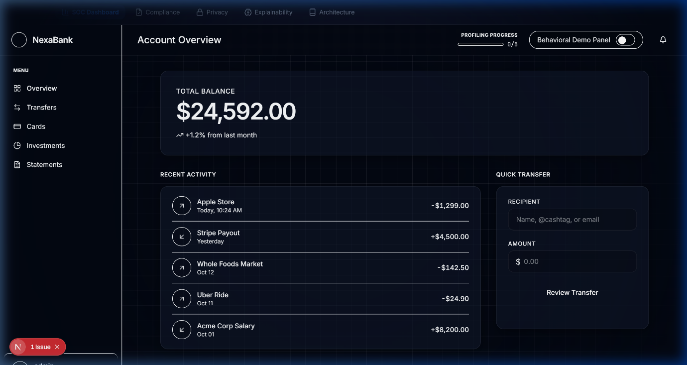
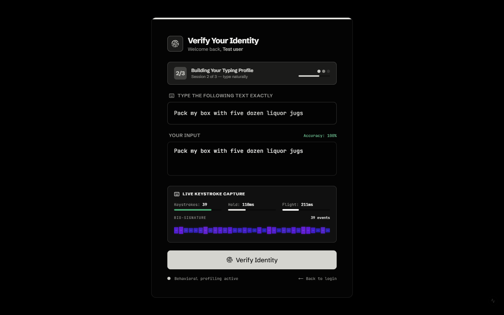

# AetherAuth: Behavioral Biometrics Continuous Authentication

Enterprise-grade continuous authentication platform using keystroke dynamics, cursor trajectory analysis, and cognitive patterns to passively verify user identity without CAPTCHAs or OTP friction. Built to meet RBI Master Directions 2021, PCI DSS 4.0, and DPDP Act 2023 compliance requirements for financial systems.


Live Application: https://frontend-dun-five-49.vercel.app

---

## Technical Overview

Static credentials and point-in-time multi-factor authentication only verify user identity at the exact moment of login. Once an initial session token is granted, conventional banking systems remain vulnerable to session hijacking, automated bots, and unauthorized access.

AetherAuth introduces continuous, passive identity verification throughout the entire lifecycle of an authenticated banking session. The platform captures fine-grained behavioral micro-telemetry from user interaction dynamics and evaluates these signals against an adaptive machine learning ensemble. Sessions exhibiting behavioral anomalies trigger an intelligent step-up challenge rather than disrupting legitimate customers with unnecessary lockouts.

---

## Application Interface & Screenshots

### Banking Dashboard & Real-Time Risk Monitor
The core banking interface displays account balances, recent transactions, and a continuous behavioral trust score. The telemetry daemon streams interaction dynamics every eight seconds, updating the session risk assessment in real time without introducing UI latency.



### Machine Learning Explainability Console
The explainability dashboard visualizes real-time scoring distributions across eight behavioral signal categories. When a risk score increases, analysts and users can immediately inspect the specific deviations observed across typing cadence, pointer acceleration, and cognitive interaction timing.


### Adaptive Step-Up Challenge
When the ensemble registers persistent behavioral deviation across consecutive evaluation intervals, the session is gated behind an automated step-up challenge. Resolving the challenge safely restores normal session privileges without terminating the user workflow.



### Regulatory Compliance & Consent Management
The compliance portal implements explicit user consent controls aligned with the Digital Personal Data Protection (DPDP) Act 2023. Users maintain granular oversight over biometric data categories with full audit logging of consent grants and revocations.


---

## Machine Learning Pipeline

The detection core combines nine machine learning engines into an ensemble that extracts over two hundred micro-behavioral features while remaining within a strict fifty millisecond inference budget.

| Engine | Primary Algorithm | Evaluated Modality |
|---|---|---|
| Keystroke Dynamics | Autoencoder and Isolation Forest | Hold times, flight intervals, digraph speed variances |
| Mouse Dynamics | LightGBM and Recurrent Neural Network | Pointer velocity, trajectory curvature, jitter, jerk |
| Cognitive Analysis | Isolation Forest | Menu pause durations, form interaction latency |
| Device Telemetry | Rule-based Heuristics | Screen orientation, touch area variance, sensor inputs |
| Anomaly Fusion | Weighted Composite Scorer | Aggregates per-modality risk scores into session trust value |

---

## Model Evaluation

These are standalone baseline detectors, not the production ensemble described above: the benchmark script builds its own scikit-learn and NumPy models and does not import the platform's code. They are benchmarked on the public CMU keystroke-dynamics dataset (Killourhy and Maxion, 2009: 51 subjects, 400 repetitions each) in `benchmarks/cmu_keystroke/`. Per subject, models train on the first 200 genuine repetitions and are tested on the remaining 200 genuine plus 250 impostor attempts. Hyperparameters were tuned on 10 held-out subjects only, and the results below are averaged over the other 41 subjects.

| Detector | Default EER | Tuned EER | Tuned AUC |
|---|---|---|---|
| Isolation Forest | 8.1% | 7.2% | 0.974 |
| k-NN distance | 8.7% | 8.6% | 0.964 |
| Scaled Manhattan (baseline) | 8.7% | 8.7% | 0.961 |
| One-Class SVM | 9.8% | 9.8% | 0.952 |
| Autoencoder (MLP) | 11.3% | 9.9% | 0.956 |
| Mahalanobis | 10.4% | 10.1% | 0.953 |

The figures in `datasets/evaluation_report.txt` come from a synthetic dataset generated by `datasets/generate_dataset.py` and are not comparable to the benchmark above.

## Regulatory and Security Architecture

The platform was designed around the strict compliance obligations mandated for Indian digital banking infrastructure.

1. RBI Master Directions 2021: Enforces continuous session monitoring, payment rail risk multipliers (UPI, IMPS, NEFT, RTGS), transaction velocity limits, and automated incident alerting.
2. DPDP Act 2023 & GDPR: Guarantees data minimization by storing behavioral features rather than raw input logs, supports automated data erasure, and records immutable consent hashes.
3. PCI DSS 4.0: Protects data at rest using Fernet symmetric encryption with automated key rotation and secures transport via TLS 1.3.
4. Cryptographic Audit Trail: All administrative operations and risk decisions are linked into an immutable SHA-256 hash-chained audit ledger to prevent retrospective tampering.

---

## Repository Structure

```text
AetherAuth/
├── app/
│   ├── api/                 # Flask RESTful API endpoints across 14 namespaces
│   ├── models/              # Machine learning ensemble definitions and feature extractors
│   ├── repositories/        # Database access layer and encryption helpers
│   └── services/            # Banking transaction risk, compliance, and audit chain logic
├── frontend/                # Next.js 16, React 19, TypeScript, and TailwindCSS application
├── database/                # Relational schemas and migration definitions
├── helm/                    # Production Kubernetes deployment specifications
├── tests/                   # 18 test suites validating security, ML, and API routes
├── docker-compose.yml       # Local orchestration for Flask, PostgreSQL, and Redis
└── Dockerfile               # Multi-stage production container build
```

---

## Getting Started

### Local Development Setup

1. Clone the repository:
   ```bash
   git clone https://github.com/harctik/behavioral-biometrics.git
   cd behavioral-biometrics
   ```

2. Configure environment variables:
   ```bash
   cp .env.example .env
   ```

3. Launch services using Docker Compose:
   ```bash
   docker-compose up --build -d
   ```

4. The backend API will be available at `http://localhost:5000` and the frontend interface at `http://localhost:3000`.

### Test sign-in (local only)

For testing on your own computer, `admin` / `admin` can open a separate test account with the admin role. It is off by default. Set these for the backend:

```bash
DEMO_LOGIN=1
FLASK_ENV=development
```

It works only for requests from this computer, and never in production, on a hosting service or through a proxy. The Next.js app forwards sign-ins to the backend from its own server, so anyone who can reach the frontend would count as local. Keep the frontend on this computer too:

```bash
cd frontend && npm run dev -- -H 127.0.0.1
```

### Executing the Test Suite

```bash
pytest tests/ -v
```

---

## Author and Engineering Details

All architecture, machine learning models, telemetry ingestion pipelines, compliance mapping, and full-stack software implementation in this repository were engineered end-to-end by Avvari Naga Harthikanand (Harthik).

Developer: Avvari Naga Harthikanand
Location: Bangalore, Karnataka, India
LinkedIn: https://www.linkedin.com/in/harthik
GitHub: https://github.com/harctik
Email: harthikanand90@gmail.com
License: MIT License
