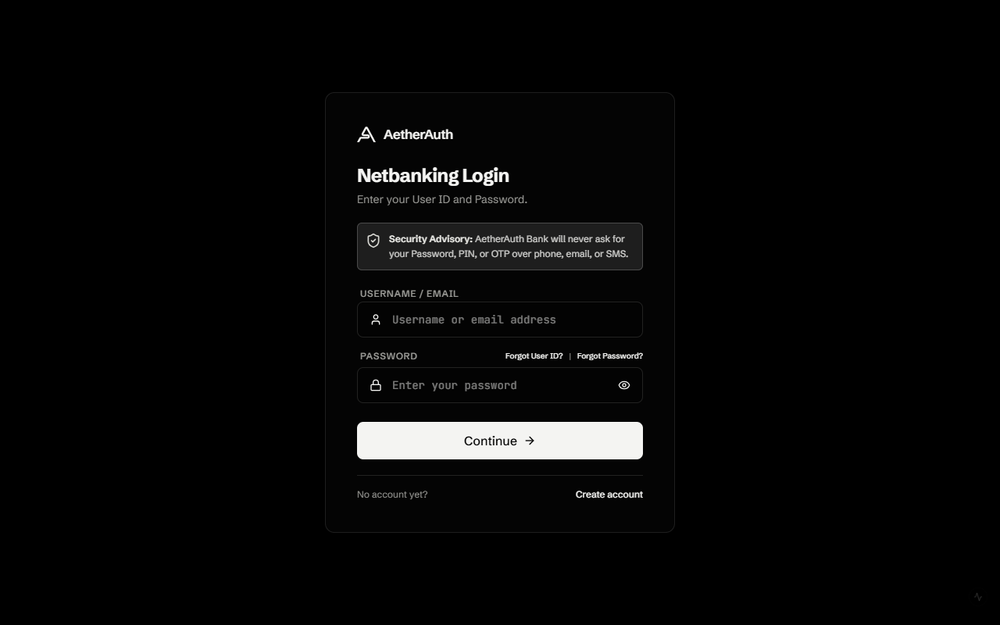
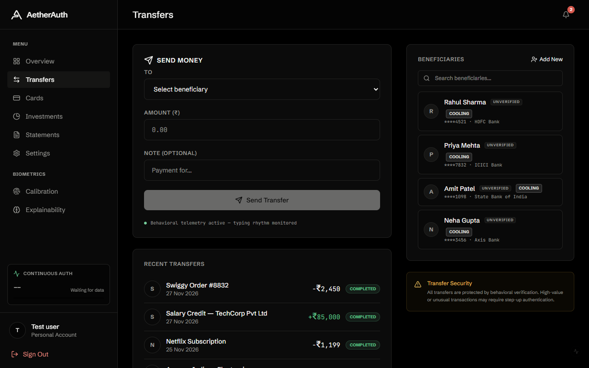

# AetherAuth

AetherAuth is a demonstration banking application for experimenting with behavioural biometrics: typing rhythm, pointer movement and interaction timing. It has a Flask API and a Next.js web interface.

It is not a banking system. Accounts, balances and bank integrations are simulated, the live risk scoring has not been validated, and nothing here has been audited against a security or regulatory standard. Read [Known limits](#known-limits) before using any part of it for something that matters.

## What it does

**Sign-in.** A password step is followed by a typing step. The server compares the typing sample with the stored profile and records a match score, but that score does not block sign-in: the behavioural decision at this point always grants access.

**Session monitoring.** The web interface sends keystroke, pointer and interaction events to the API, about every ten seconds in normal operation. The server turns them into a session risk score using a weighted sum of 12 signals from separate scoring modules, many of them rules and heuristics. If one of these modules fails, the request carries on with a default value. The interface can send a user back to the typing step when risk is high.

**Transfer checks.** A transfer assessment combines the session's behaviour with a velocity limit, a daily limit, a time-of-day rule, payment-rail multipliers (UPI, IMPS, NEFT, RTGS) and the user's transaction history. It returns a decision and writes an audit record. It does not move money.

**Other parts.** TOTP and one-time-code endpoints, a dashboard, transfer, card and investment screens, administrator endpoints, and a hash-chained audit table. API documentation is served by the backend at `/api/v1/`.

## Screenshots

Captured from a local run with a throwaway database. The test account's name was replaced with "Test user" and the Next.js development indicator was hidden. The figures and people shown are placeholder or simulated data.

| Sign-in | Typing step |
|---|---|
|  |  |

| Dashboard | Transfers |
|---|---|
|  |  |

## What is real and what is simulated

| Area | Status |
|---|---|
| Password accounts, JWT cookies, CSRF protection, login lockout | Implemented, with gaps. See [Known limits](#known-limits). |
| Collection of keystroke and pointer events | Implemented. |
| Behavioural check at sign-in | Scored and logged. Not enforced. |
| Session risk score | Computed from heuristics and scoring modules. Not validated. Where raw data is converted into features, some inputs are filled with fixed "human-like" defaults. |
| Bayesian fusion | The function exists, but no API route calls it. |
| Account balance and statements | Simulated. They start from mock figures, including a made-up salary entry. |
| Core banking (CBS) | Mock adapters and an in-memory ledger. The adapters report themselves as connected with a fixed latency. No bank is contacted. |
| NPCI risk and mule-account detection | Simulated. |
| Cards and investments | Mock data and simulated actions, including mock CVVs. |
| Transfer history | When there are fewer than 10 real entries, the API adds 12 invented ones. |
| Dashboard activity, beneficiaries, notifications | Parts of the interface show seeded or hard-coded demo content. The transfers page also has fixed fallback scores and a fixed success message. |
| Beneficiary cooling-off | Shown as a label. The transfer assessment does not check it. |
| Compliance reports | The statuses and scores are fixed values written in `app/compliance/__init__.py`. They are not the result of any check. The CERT-In function returns a draft and sends nothing. |
| Consent records | The consent check is not applied by the application's data collection. |
| Data erasure | Partial. Anonymising a user renames and deactivates the account and clears raw behavioural payloads. It keeps derived features and does not touch the keystroke event table. |
| Audit table | Each record is chained to the previous one with SHA-256. This can reveal some edits, but the table is not immutable or tamper-proof. |
| Encryption at rest | Behavioural features are Fernet-encrypted only when `BACKUP_FERNET` is set in the environment. Keystroke and pointer event tables are not encrypted. Key rotation is a manual script that re-encrypts backup codes only. |
| Transport security | The application does not terminate TLS. That is left to whatever hosts it. |

## Architecture and layout

```text
Browser  ->  Next.js (frontend/)  ->  Flask API (app/)  ->  SQLite or PostgreSQL
             pages, event collector   routes, services,     Redis (optional)
                                      scoring modules
```

```text
app/
  api/              Flask-RESTX routes, 15 namespaces
  services/         authentication, transaction assessment, mock CBS
  repositories/     database access for some domains
  models/           feature extraction and scoring models
  banking/          mock core-banking adapters
  compliance/       compliance report and data-request code
  ml_ensemble.py    signal fusion
  database.py       database layer
  app_impl.py       application setup
  config.py         settings
frontend/src/       Next.js 16, React 19, TypeScript
alembic/            database migrations
benchmarks/         standalone keystroke benchmark
datasets/           synthetic data and its generator
tests/              pytest suite
docs/               design notes, model card, runbook, screenshots
helm/               Kubernetes chart (not tested for this README)
```

The files in `docs/` include design intentions that the code does not fully meet. Where they differ, [Known limits](#known-limits) takes precedence.

## Run it locally

These steps run the backend with SQLite and without Redis. Use Python 3.10 or later; CI uses Python 3.10 and Node.js 20.

Redis-dependent protections do nothing in this setup, including token revocation and single use of TOTP codes.

### Backend

```bash
git clone https://github.com/harctik/behavioral-biometrics.git
cd behavioral-biometrics
python -m venv .venv
source .venv/bin/activate            # PowerShell: .\.venv\Scripts\Activate.ps1
pip install -e ".[dev]"
```

Set the environment in the shell that will run the backend. In bash:

```bash
export FLASK_ENV=development
export SECRET_KEY=$(python -c "import secrets; print(secrets.token_hex(32))")
export JWT_SECRET_KEY=$(python -c "import secrets; print(secrets.token_hex(32))")
export TXN_SIGNING_KEY=$(python -c "import secrets; print(secrets.token_hex(32))")
```

In PowerShell:

```powershell
$env:FLASK_ENV = "development"
$env:SECRET_KEY = python -c "import secrets; print(secrets.token_hex(32))"
$env:JWT_SECRET_KEY = python -c "import secrets; print(secrets.token_hex(32))"
$env:TXN_SIGNING_KEY = python -c "import secrets; print(secrets.token_hex(32))"
```

Then start it:

```bash
python -m flask --app run:app --debug run --host 127.0.0.1 --port 5000 --no-debugger
```

Use this command rather than `python run.py`, which is not limited to your own computer. Without `--debug`, the application redirects plain HTTP requests to HTTPS.

The default database is `database/auth_system.db`. Set `SQLALCHEMY_DATABASE_URI` to use another one.

`BACKUP_FERNET` is optional for local use. Without it, the application makes a temporary key at each start, so anything encrypted with that key cannot be read after a restart, and behavioural features are stored unencrypted. To keep a key, generate one and store it somewhere private:

```bash
python -c "from cryptography.fernet import Fernet; print(Fernet.generate_key().decode())"
```

Other settings are listed in [ENV_VARS.md](ENV_VARS.md). Its defaults were not all checked against the code.

### Frontend

In a second terminal:

```bash
cd frontend
npm ci
npm run dev -- -H 127.0.0.1
```

Open `http://127.0.0.1:3000`. The frontend expects the API at `http://127.0.0.1:5000`. If the API runs elsewhere, set both `BACKEND_URL` and `NEXT_PUBLIC_API_URL` to its address: the server-side routes read the first and then the second, while the rewrites and content security policy read only the second.

On Windows, a deeply nested checkout can make Turbopack fail because of path length. Move the repository to a shorter path, or run `npm run dev -- -H 127.0.0.1 --webpack`.

The repository also has `Dockerfile` and `docker-compose.yml`. They were not run for this README, and the Celery worker service in the Compose file points to a module that does not exist.

### Local test sign-in

There is an optional test sign-in for use on your own computer. It is off by default. To enable it:

1. In the backend shell, set `DEMO_LOGIN=1` as well as `FLASK_ENV=development`, then start the backend. These must be real environment variables; do not rely on a `.env` file.
2. Start the frontend with `npm run dev -- -H 127.0.0.1`.
3. On the sign-in page, enter the username and password defined by the constants at the top of [`app/demo_login.py`](app/demo_login.py). The typing step still follows.

It opens a separate account with administrator privileges, whose stored password is random. It will not open an existing real account with the same username.

The backend accepts it only when `FLASK_ENV` is not `production`, none of the hosting variables it knows about is set (Render, Vercel, Heroku, Railway, Cloud Run), the request has no proxy headers, and the request comes from the loopback address.

The `-H 127.0.0.1` option is required for safety. The Next.js server forwards sign-ins to the backend itself without proxy headers, so to the backend every visitor to the frontend looks local. By default the development server listens on all interfaces. Do not enable the test sign-in on a shared or reachable machine, or behind a tunnel or reverse proxy.

## Tests and CI

```bash
pytest tests/ --cov=app
```

Running the tests or the application can overwrite tracked files under `models/`. Restore them with `git checkout -- models/` if you did not mean to change them.

Local result on Python 3.10 (Windows): 380 passed, 7 skipped, coverage 54%. The required minimum is 50%. The coverage figure is narrower than it looks: `pyproject.toml` leaves a number of modules out of measurement, including several scoring and banking modules, and excludes some lines such as broad exception handlers.

Locally, `black --check app tests`, `ruff check app tests`, `mypy app --ignore-missing-imports` and `bandit -r app -ll` also passed. The mypy result depends on a baseline in `pyproject.toml` that ignores errors in 30 modules. With `-ll`, Bandit fails only on medium and high severity findings.

The workflow in `.github/workflows/ci.yml` runs on pushes and pull requests to `main` and `develop`:

| Job | What it runs |
|---|---|
| lint | Black, Ruff, mypy |
| frontend-build | `npm ci`, lint, build. No frontend tests are run. |
| test | pytest with coverage |
| security | Bandit, Safety, pip-audit |
| docker | Image build. Skipped on pull requests. |

The final "All Checks Passed" job depends on the docker job, so it is likely to be skipped on pull requests. These results describe local runs; the workflow itself was not run for this README.

## Keystroke benchmark

`benchmarks/cmu_keystroke/` evaluates standalone scikit-learn and NumPy detectors on the public CMU keystroke dataset (Killourhy and Maxion, 2009). It does not import the application's code, so **these figures say nothing about how well AetherAuth performs**.

Setup: 51 subjects with 400 repetitions each. Each detector trains on a subject's first 200 repetitions and is tested on the other 200 plus 250 impostor attempts. Hyperparameters were tuned on 10 subjects, and results are averaged over the other 41. The table matches the committed `results.json`; the benchmark was not run again for this README.

| Detector | Default EER | Tuned EER | Tuned AUC |
|---|---|---|---|
| Isolation Forest | 8.1% | 7.2% | 0.974 |
| k-NN distance | 8.7% | 8.6% | 0.964 |
| Scaled Manhattan | 8.7% | 8.7% | 0.961 |
| One-Class SVM | 9.8% | 9.8% | 0.952 |
| Autoencoder (MLP) | 11.3% | 9.9% | 0.956 |
| Mahalanobis | 10.4% | 10.1% | 0.953 |

Combining Isolation Forest with k-NN gave 7.3% EER and 0.972 AUC, which did not improve on the best single detector. `datasets/evaluation_report.txt` is based on synthetic data and is not comparable.

The application's own accuracy and latency have not been measured here. Some optional models need the extra packages in `requirements-ml.txt`, which were not installed for the local test run.

## Known limits

Do not deploy this with real users or real data. This is a demonstration, and reading the code showed gaps that make it unsafe for that. This is not a complete security review.

- **Security:** authentication, session access control, account recovery, production configuration and transfer checks all need review and hardening.
- **Privacy:** the application collects typing and pointer activity. Some of it is stored unencrypted and can include typed text. Consent is not enforced and erasure is partial. Enter test data only.
- **Redis:** several protections depend on it and are not enforced without it.
- **Scoring:** behaviour never blocks sign-in, and the risk score and its thresholds have not been validated.
- **Explanations:** the explainability page shows fixed text that does not reflect how the server computes the score.

## Author and Engineering Details

All architecture, machine learning models, telemetry ingestion pipelines, compliance mapping, and full-stack software implementation in this repository were engineered end-to-end by Avvari Naga Harthikanand (Harthik).

Developer: Avvari Naga Harthikanand
Location: Bangalore, Karnataka, India
LinkedIn: https://www.linkedin.com/in/harthik
GitHub: https://github.com/harctik
Email: harthikanand90@gmail.com
